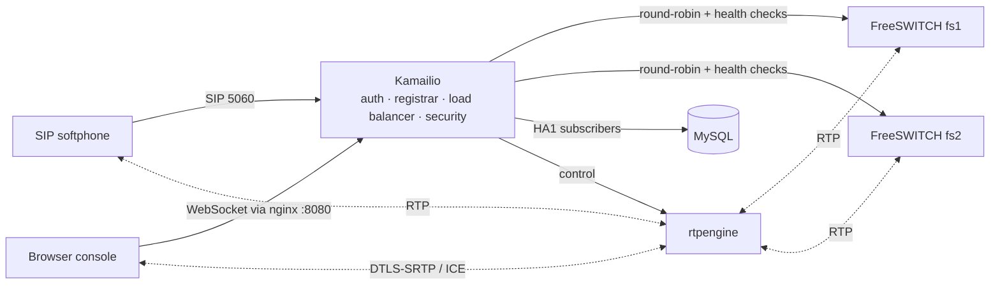

# VoxHarbor

**A fault-tolerant SIP platform in Docker: Kamailio in front, two FreeSWITCH nodes behind it, and rtpengine carrying the audio.**

Phones and browsers register with Kamailio. Calls are spread across FreeSWITCH nodes with health checks and instant failover, and media flows through rtpengine, which also bridges browser WebRTC to plain RTP. Every claim below is backed by a SIPp test you can re-run.



## Results

Measured on a single laptop (i7-10750H, WSL2). Full details are in [docs/results.md](docs/results.md).

| Test | Result |
|---|---|
| 600 calls at 5 / 10 / 20 calls/s | **100 % success**, ~8 ms average call setup, peak CPU ≤ 14 % per container |
| Load balancing, 20 calls | **10 / 10** split between fs1 and fs2 |
| `docker stop fs1` during 60 calls | **58 / 60 succeed**. Only calls in progress on fs1 drop; new calls retry instantly on fs2 |
| `docker start fs1` | back in rotation in **4 s** |
| Real audio through rtpengine (echo) | ~230 packets each way, relayed on both legs |
| Flood of 500 req/s from one IP | **banned after ~1 s** (request #510), other clients unaffected |
| `friendly-scanner` / `SIPVicious` / `sipcli` | silently dropped |
| Wrong password | **403 Forbidden**. Passwords stored only as HA1 hashes |

## What it demonstrates

- **Signalling and media separated:** Kamailio never touches audio, and FreeSWITCH is never exposed to the outside.
- **Loop-free B2BUA routing:** requests from a FreeSWITCH node (`ds_is_from_list`) go to `lookup("location")`; everything else is authenticated and dispatched.
- **Load balancing with failover:** dispatcher round-robin, OPTIONS health checks every 10 s, and on a 408 or 5xx, `ds_mark_dst` + `ds_next_dst` retry on the next node.
- **WebRTC ↔ SIP:** browsers (DTLS-SRTP, ICE) and SIP phones (RTP) call each other through rtpengine, while FreeSWITCH only sees plain RTP.
- **Security:** `pike` + `htable` ban list, scanner User-Agent filter, HA1-only credentials, a FreeSWITCH ACL that admits only Kamailio, and secrets in `.env`.
- **Reproducible:** every image is pinned, and the setup is one `docker compose up`, with test scripts and recorded results.

## Stack

| Component | Version | Role |
|---|---|---|
| Kamailio | 6.0.6 (Alpine 3.22) | SIP proxy, registrar, digest auth, dispatcher, security |
| FreeSWITCH ×2 | 1.10.12 (Alpine 3.22, no SignalWire token needed) | B2BUA: echo, IVR, which-node, bridging |
| rtpengine | 12.2.1.4 (Alpine 3.22) | Media relay, NAT, WebRTC bridge |
| MySQL | 8.4.7 | Subscribers (HA1) and registrations |
| nginx | 1.27.5 | Browser console + WebSocket proxy |
| SIPp | 3.7.3 | Load, failover, media, DTMF and security tests |
| JsSIP | 3.10.1 | Browser softphone library (vendored) |

## Quick start

Requirements: Docker Engine with Compose v2, and about 1 GB of RAM free.

```bash
git clone https://github.com/afaqakbarvirk/voxharbor.git
cd voxharbor
cp .env.example .env
# edit .env: EXTERNAL_IP = the IP your softphones use to reach this host (`hostname -I`),
#            then set your own passwords
docker compose up -d --build
docker compose ps        # all services Up / healthy within ~30 s
```

MySQL creates the schema and subscribers **1001-1099** on first start, all with `SIP_USER_PASSWORD`.

### Make a call

**Browser:** open **http://localhost:8080**. It has to be `localhost`, because browsers only allow the mic on `localhost` or HTTPS. Sign in Line A as `1001` and Line B as `1002`, then use the quick-dial tiles. Keyboard: digits, `Enter` to call or answer, `Esc` to hang up.

**Softphone** (MicroSIP, Zoiper, Linphone):

| Setting | Value |
|---|---|
| SIP server / domain | `EXTERNAL_IP`, port 5060, UDP |
| Username / auth user | `1001` … `1099` |
| Password | `SIP_USER_PASSWORD` from `.env` |

| Dial | What happens |
|---|---|
| `9196` | Echo test: you hear yourself |
| `5000` | Demo IVR: 1 = echo test, 2 = which node, 9 = repeat |
| `9999` | "You are number one / two": tells you which FreeSWITCH node answered |
| `1001`-`1099` | Calls another registered user (softphone or browser) |

## Tests

```bash
bash scripts/load-test.sh                     # staged load: 5, 10, 20 calls/s × 200 calls
bash scripts/load-test.sh -r "10" -n 500      # custom rate / count
bash scripts/failover-test.sh                 # kill fs1 mid-load, measure drops, retries and rejoin
bash scripts/failover-test.sh -v fs2 -n 100   # kill fs2 instead
```

Individual SIPp scenarios live in [`sipp/scenarios/`](sipp/scenarios): `register`, `uac_auth`, `uac_media` (real audio), `uac_dtmf` (IVR), `uac_webrtc` (browser-style offer) and `options` (scanner and flood probes).

Useful checks:

```bash
docker exec kamailio kamcmd dispatcher.list      # node state: AP = active, IP = inactive/probing
docker exec kamailio kamcmd ul.dump              # registrations
docker exec kamailio kamcmd htable.dump ipban    # banned IPs
docker exec fs1 fs_cli -x "show calls"           # calls on a node
docker logs rtpengine | grep "Final packet"      # per-call media stats
```

## Repository layout

```
├── docker-compose.yml          # all services, voxnet 172.28.0.0/24, pinned images
├── .env.example                # EXTERNAL_IP, SIP realm/password, MySQL passwords
├── kamailio/                   # kamailio.cfg, dispatcher.list, Dockerfile
├── freeswitch/                 # Dockerfile + conf/ (vars, ACL, internal profile, dialplan), shared by fs1 and fs2
├── rtpengine/                  # rtpengine.conf, Dockerfile
├── mysql/init/                 # Kamailio schema + HA1 subscriber provisioning
├── nginx/default.conf          # console + /ws proxy
├── web/                        # browser console (HTML/CSS/JS, JsSIP)
├── sipp/                       # toolbox image + scenarios
├── scripts/                    # load-test.sh, failover-test.sh
└── docs/                       # architecture.md (diagrams, call flows), results.md (measurements)
```

## Design notes

See **[docs/architecture.md](docs/architecture.md)** for call-flow diagrams, the socket layout, how failover works and the security layers.

## Production gaps (by design, this is a lab)

- **Single points of failure remain:** Kamailio and MySQL are single instances. Production would run two Kamailio nodes behind a floating IP or DNS SRV, plus replicated MySQL.
- **No encryption on the SIP phone side:** it uses UDP and RTP. Add TLS (5061) and SRTP for real deployments. Browser media is already DTLS-SRTP.
- **Calls in progress on a crashing node are lost.** New calls fail over instantly.
- **No PSTN trunk, CDRs/billing, or monitoring** (Homer, Prometheus) yet.
- **Rate limits are tuned for one laptop:** the 101-port RTP range carries ~25 concurrent calls, and pike allows ~25 calls/s per source IP.
