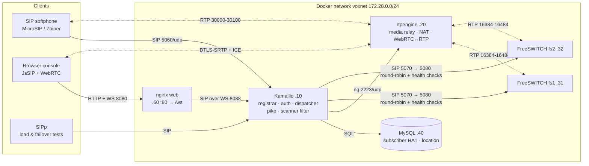
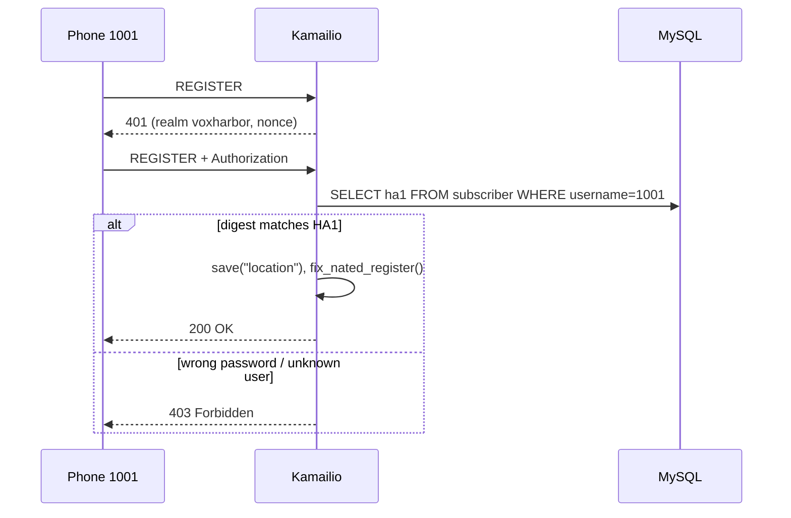
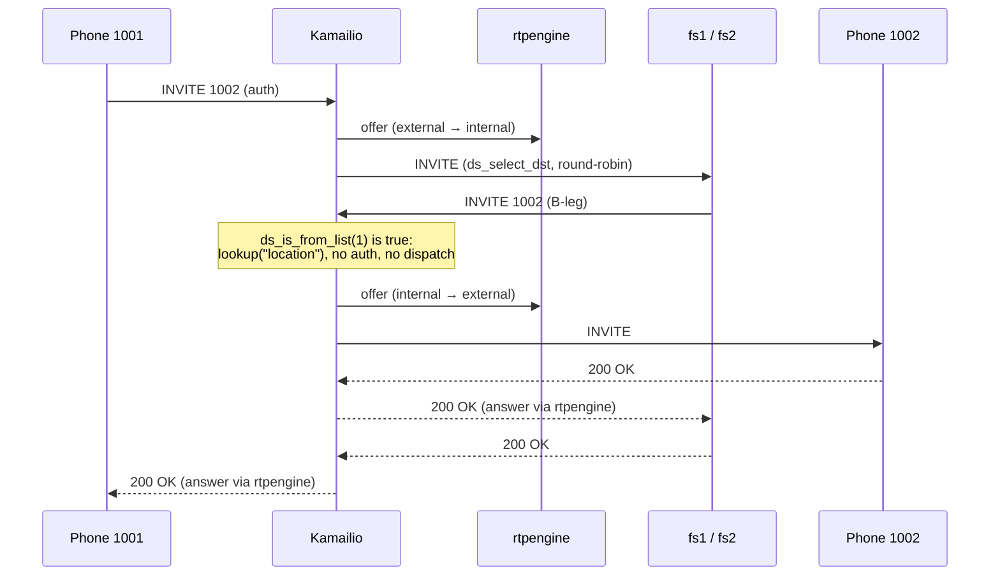
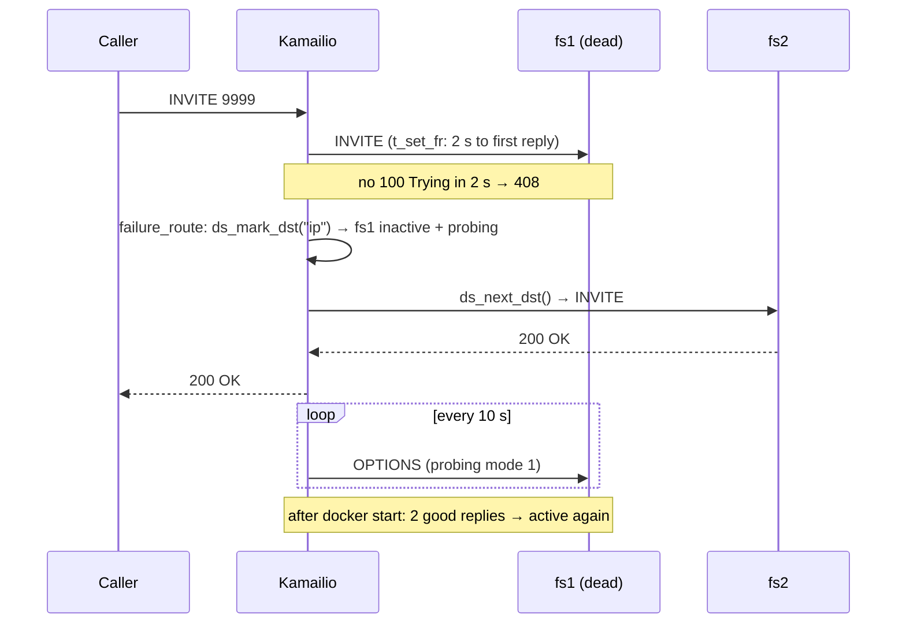

# VoxHarbor architecture

VoxHarbor separates **signalling** from **media**, the same split that carrier and hosted-PBX platforms use:

- **Kamailio** decides *where* a call goes. It handles authentication, load balancing and security, and never touches audio.
- **rtpengine** carries the audio, fixes NAT, and converts browser WebRTC media to plain RTP and back.
- **FreeSWITCH** (×2) runs the applications: echo test, IVR and bridging. It only ever talks to Kamailio and rtpengine.

Solid lines are signalling; dotted lines are media.

## Components

| Container | IP | Role | Published to host |
|---|---|---|---|
| `kamailio` | 172.28.0.10 | SIP proxy, registrar, digest auth (MySQL, HA1), dispatcher, rtpengine control, flood/scanner protection | 5060 udp/tcp |
| `rtpengine` | 172.28.0.20 | Media relay. Two logical interfaces: `internal` (towards FreeSWITCH) and `external!<host IP>` (towards phones) | RTP 30000-30100/udp |
| `fs1`, `fs2` | 172.28.0.31/.32 | FreeSWITCH B2BUA nodes running the same mounted config. SIP accepted only from Kamailio (ACL) | none |
| `mysql` | 172.28.0.40 | Kamailio schema: `subscriber` (HA1 only), `location` | none |
| `web` | 172.28.0.60 | nginx: browser console + `/ws` proxy to Kamailio's WebSocket listener | 8080 |
| `sipp` | 172.28.0.50 | SIPp, sngrep and tcpdump toolbox for the tests | none |

Every image is pinned: Alpine 3.22 packages for Kamailio 6.0.6, FreeSWITCH 1.10.12, rtpengine 12.2.1.4 and SIPp 3.7.3; `mysql:8.4.7`; `nginx:1.27.5-alpine`.

## Kamailio sockets

Kamailio listens on separate sockets for each side, so the two legs of a call never get mixed up:

| Socket | Faces | Notes |
|---|---|---|
| `udp/tcp 172.28.0.10:5060` advertised as `<host IP>:5060` | phones | Record-Route and Via carry the host IP that phones can reach |
| `udp 172.28.0.10:5070` | FreeSWITCH | dispatcher pings and dispatched INVITEs leave from here |
| `tcp 172.28.0.10:8088` | nginx `/ws` | SIP over WebSocket for browsers |

Because the inbound and outbound sockets differ, `record_route()` inserts two Record-Route headers, so in-dialog requests come back on the correct side.

## Call flows

### Registration with digest auth

Passwords never appear in the database: `02-subscribers.sh` stores only `MD5(user:realm:password)`.

### Phone to phone (loop prevention)

FreeSWITCH is a B2BUA, so a call between two phones crosses Kamailio twice. The first rule in the request route decides which way a request goes:

Without `ds_is_from_list()`, the B-leg would be authenticated and dispatched straight back to FreeSWITCH, and the call would loop.

### Failover

- **Health checks:** OPTIONS every 10 s (`ds_ping_interval`). A node changes state after 2 failures or 2 successes (`ds_probing_threshold` / `ds_inactive_threshold`).
- **Instant retry:** a 408 or 5xx, or no provisional reply within 2 s, marks the node down and re-sends the INVITE to the next node. The caller just sees a slightly slower ring.
- **Calls already in progress** on a node that dies are lost: FreeSWITCH holds that call state. Surviving them would need shared call state or SIP re-INVITE recovery, which is out of scope here.

### Media path and WebRTC

Kamailio runs `rtpengine_manage()` on both legs. Since every dialog is phone ↔ FreeSWITCH, the direction is decided by where a message comes from:

| Message from | rtpengine direction | Profile on the outgoing side |
|---|---|---|
| A phone or browser | `external → internal` | FreeSWITCH always gets plain `RTP/AVP`, ICE removed, rtcp-mux demuxed |
| FreeSWITCH, to a SIP phone | `internal → external` | plain `RTP/AVP` |
| FreeSWITCH, to a browser (WS contact or SAVPF caller) | `internal → external` | `UDP/TLS/RTP/SAVPF`, ICE forced, DTLS passive, rtcp-mux |

So FreeSWITCH never sees WebRTC, and a browser can call a SIP phone or another browser. Codecs are restricted to Opus, PCMU and PCMA (plus telephone-event for DTMF) with `codec-strip=all codec-except=...`. RFC 2833 DTMF passes through rtpengine to the IVR.

## Security layers

| Layer | Where | What it does |
|---|---|---|
| Scanner filter | Kamailio `route[SECURITY]` | Drops requests whose User-Agent matches friendly-scanner, sipvicious, sipcli, sipsak and similar. No reply is sent, so scanners learn nothing |
| Flood ban | `pike` + `htable ipban` | More than 250 requests per 2 s from one IP bans it for 300 s; later packets are dropped before any processing. FreeSWITCH nodes and the WS proxy are exempt |
| Digest auth | `auth_db` | Every request from the phone side must authenticate. A wrong password gets 403 |
| FreeSWITCH ACL | `acl.conf.xml` | FreeSWITCH accepts SIP only from 172.28.0.10. A direct INVITE gets 403 |
| Network exposure | docker-compose | MySQL, FreeSWITCH and the rtpengine control port are never published to the host |
| Secrets | `.env` (gitignored) | DB passwords and the SIP password. `.env.example` ships placeholders |

## Port map

| Host port | Container | Purpose |
|---|---|---|
| 5060/udp, 5060/tcp | kamailio | SIP from softphones |
| 8080/tcp | web | browser console + SIP over WebSocket (`/ws`) |
| 30000-30100/udp | rtpengine | RTP / SRTP to phones and browsers |

## Lab-specific choices

- **WSL2 in NAT mode (Windows 10):** softphones on the Windows host reach WSL at its NAT IP. That IP goes in `.env` as `EXTERNAL_IP` and becomes Kamailio's advertised address and rtpengine's external interface. It can change after a WSL restart.
- **Browsers** only grant microphone access on `https://` or `http://localhost`, so the console is served on `localhost:8080`, which WSL forwards to the host.
- **rtpengine runs in userspace** (`table = -1`): WSL has no `xt_RTPENGINE` kernel module. That's fine at lab scale.
- **The RTP range of 101 ports** carries about 25 simultaneous calls (4 ports per call). Widen `port-min`/`port-max` and the published range for more.
